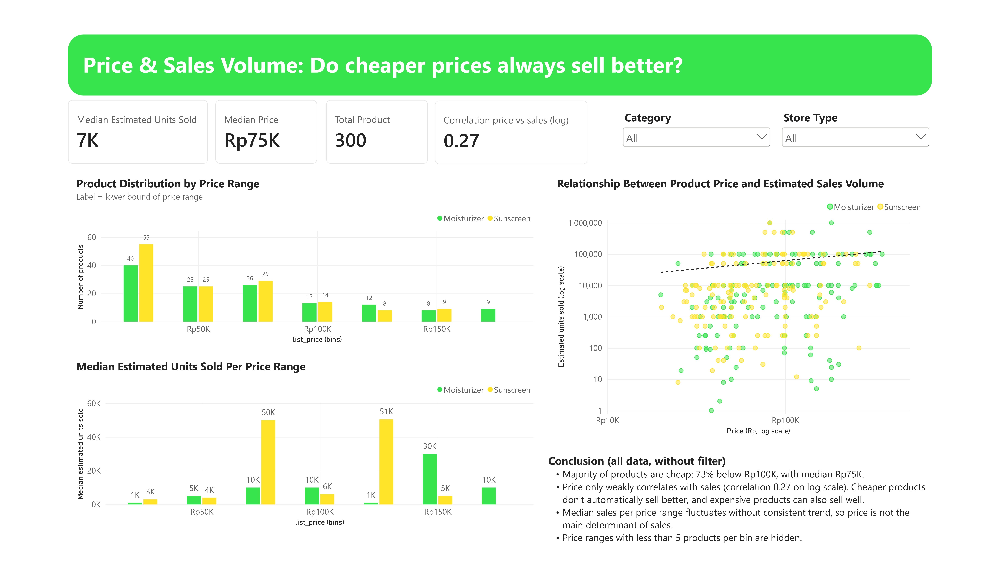
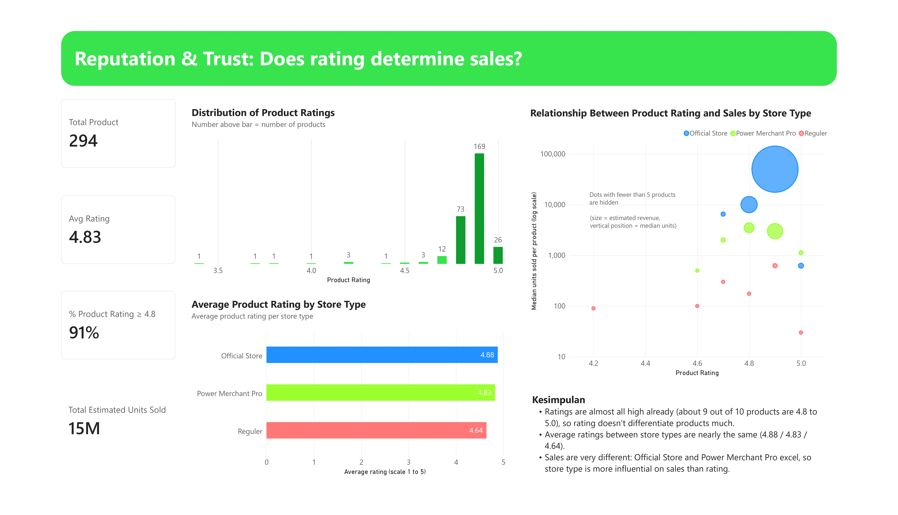
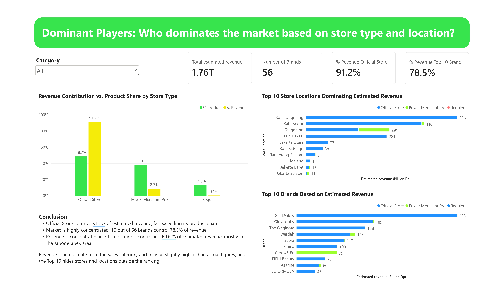

# 📊 Tokopedia Skincare Market Analysis: Moisturizer & Sunscreen

> 🛡️ **Ethical Data & Compliance Notice:**
> This project is made only for **learning and non-commercial purposes**. To follow the platform's Terms of Service (ToS) and protect data privacy, **the raw scraped data, the specific selectors, and personal information (PII) are not uploaded** to this repository. This repository only shares anonymized, aggregated *insights* and synthetic sample data. *(See the full [Disclaimer & Ethical Considerations](#-disclaimer--ethical-considerations) at the bottom.)*

## 📌 Project Overview
This project analyzes the *skincare* market (mainly *Moisturizer* and *Sunscreen*) on Tokopedia. The goal is to understand pricing strategy, customer trust, and market dominance. The dashboard gives *actionable insights* to sellers and brand managers. They can use these insights to improve pricing, store reputation, and regional targeting.

## 🎯 Business Questions
1. **Price & Sales:** Does a lower price always lead to higher sales volume?
2. **Reputation & Trust:** Does a high product rating guarantee better sales? How does store type affect customer trust?
3. **Market Dominance:** Which brands, store types, and locations take the biggest share of estimated revenue?

## 💡 Key Insights
Based on the data analysis, these are the main findings:
- 💰 **Price vs. Sales:** There is only a **weak correlation (0.27)** between price and sales (log scale). 73% of products cost less than Rp100K (median: Rp75K). However, expensive products can still sell well. Price is not the main driver of sales.
- ⭐ **Rating vs. Store Type:** Ratings are mostly high (9 out of 10 products have a rating between 4.8 and 5.0). This makes it hard to compare products by rating alone. But **store type** matters a lot. *Official Stores* and *Power Merchant Pro* stores sell much more than *Regular* stores.
- 🏆 **Market Concentration:** The market is highly concentrated. **Official Stores** take **91.2%** of the estimated revenue. Also, the **Top 10 Brands** (led by Glad2Glow, Glowsophy, and The Originote) take **78.5%** of the total revenue.
- 📍 **Geographic Dominance:** Revenue is concentrated in the **Greater Jakarta area (Jabodetabek)** (Kab. Tangerang, Kab. Bogor, Tangerang, Kab. Bekasi). This area controls almost **70%** of the estimated revenue.

## 🛠️ Tools & Techniques
- **Data Visualization & BI:** Power BI Desktop
- **Data Transformation (ETL):** Power Query (data cleaning, handling missing values, creating price bins, and merging tables)
- **Data Modeling:** *Star Schema*, with relationships between the Product, Store, and Sales tables.
- **DAX (Data Analysis Expressions):** Measures for Estimated Revenue and Median Units Sold, correlation calculation, and dynamic binning.

## ⚠️ Disclaimer & Ethical Considerations
**Purpose.** This project is made for learning and non-commercial use. The data was taken from public Tokopedia pages (*sunscreen* and *moisturizer* categories, maximum 5 pages per category) in October 2026. This project is not affiliated with, sponsored by, or endorsed by Tokopedia/TikTok. All brands and content belong to their respective owners.

**What is hidden from the code.** To prevent misuse, these parts are left empty on purpose in this repository:
- The target scraping URL (`BASE_URL`)
- The CSS selectors for product name, price, rating, and units sold
- Other specific settings that point to the structure of Tokopedia pages

Users must fill in these values themselves in `config_example.py`.

**What is not uploaded.**

| Original file/folder | Reason |
|---|---|
| `data/raw/` (raw scraped data) | To avoid sharing the data again and to respect the ToS |
| `config.py` (real URL and selectors) | Hidden, see above |
| Transformed datasets that still contain product-level or store-level data | Only aggregated results are published |

**Replacement files that are uploaded.**

| File | Description |
|---|---|
| `verify_env_example.py` | Template with empty values |
| `config_example.py` | Template with empty values |
| `scraper_example.py` | Template with empty values |

**Personal data.** There are no seller or buyer names, contact details, addresses, or review texts. The analysis uses only aggregated numbers.

**User responsibility.** Anyone who runs this code must follow Tokopedia's Terms & Conditions and the applicable laws. The author is not responsible for any misuse of this code. The scraper uses delays between requests and does not try to bypass the site's protection.

## 🚀 Experience the Live Dashboard
Instead of just looking at static screenshots, interact with the data yourself! The dashboard is hosted on Power BI Service.
🔗 [Click here to launch the interactive dashboard](https://bit.ly/vista-tokopedia-dashboard)

## 📝 Future Improvements
- Add *predictive analytics* to forecast sales based on seasonal trends.
- Add *sentiment analysis* using product reviews to support the rating metric.
- Create dynamic parameters so users can filter and simulate different pricing strategies.

---
*Created by Vista Sasmita Padmanagara | Data Analyst Portfolio*
